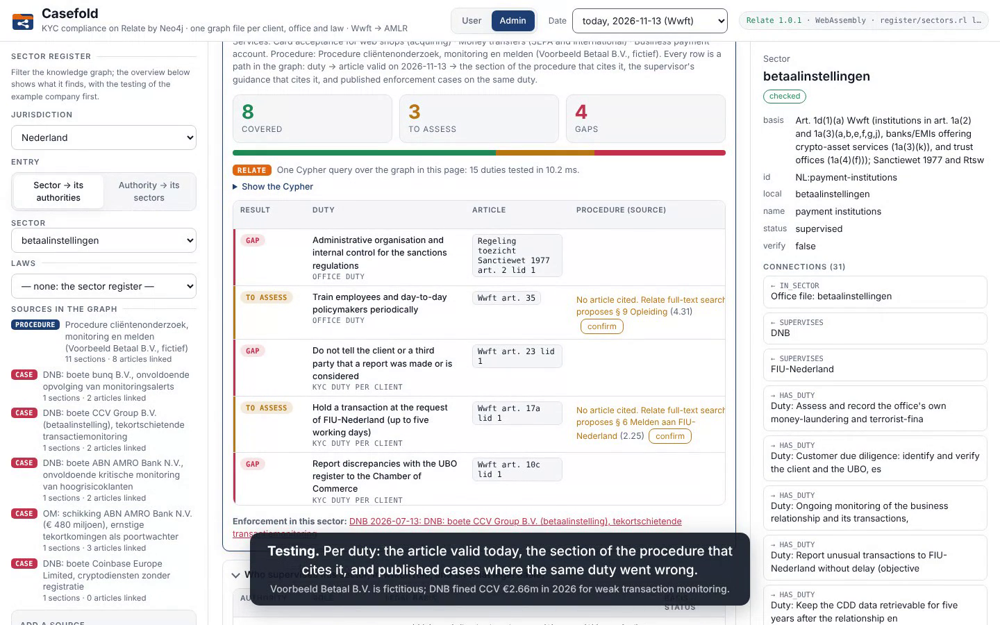

# Casefold — KYC compliance as connected context, on Relate

> **Relate by Neo4j Hackathon 2026.** Casefold turns anti-money-laundering compliance into one connected graph: the law, the supervisor's rules, a company's own procedure and published enforcement cases. An office can then see, per duty, what the law asks, what its procedure does, and where it went wrong before, today and once the EU AMLR replaces the Dutch Wwft on 10 July 2027. Every answer is a Cypher query in Relate, with its source.

**Try it in two minutes.** Open the viewer online on GitHub Pages (`https://<owner>.github.io/<repo>/`, published from `web/` by `.github/workflows/pages.yml`), or locally: `cd web && python3 -m http.server 8000`, then http://localhost:8000. It needs no build, because the data is committed. Relate runs in the page in WebAssembly.
1. **User**: the demo client *Kalmora Europe B.V.*, a client file of its own: owners, documents, transactions, the client's customers (KYCC). Run question 03: who is the beneficial owner, ground by ground, with the article.
2. **Admin**, sector *betaalinstellingen*: the **testing** of the fictitious example company *Voorbeeld Betaal B.V.* Per duty the article valid on the date, the section of its procedure that cites it, and published DNB/OM cases on the same duty. Where no article is cited, Relate's full-text index proposes a section; confirm it with one click.
3. Switch the date to **10 July 2027**: every duty moves to its AMLR article (`REPLACED_BY`), the EUR 15,000 threshold becomes EUR 10,000, and the procedure, which still cites the Wwft, shows the work to do.
4. **Add a source**: drop in a PDF, the official XML of wetten.overheid.nl or a text, as a law, the supervisor's guidance, a procedure or an enforcement case. It is read into the graph in the page, and its citations ("artikel 16 Wwft", "AMLR art. 69") are linked to the duties.

5. **Your own data, in the browser**: click **+ New client from documents** under the client list. You start with a fresh test client: no documents, no structure. Then:
   - add the client's files, or press *Use the example documents* (a structure chart PDF and a scanned UBO register extract);
   - press *Read into the graph*. The chart is read box by box and line by line from its vector paths, and the scan with OCR (Tesseract compiled to WebAssembly, in the page). Every fact becomes a proposal that points to its place in the chart;
   - *Confirm all*, or confirm per row.

   The review follows straight away: 2 of 16 required documents present, each missing one with its article; 3 beneficial owners; Lina Brouwer (veto, 16%) is not in the UBO register; and a request to the client, ready to copy. All of this happens in the tab, and nothing is sent anywhere. The same steps exist on the command line, `python3 casefold/new_client.py examples/kalmora-from-documents` (see [Your own client](#your-own-client-from-the-documents-it-delivers)). The client *Kalmora Europe B.V. · built from its own documents* is the result of that route.



Demo video (1:59, with voice-over; 0:17 exploring the graph, 0:34 New client from documents in the browser, 1:28 the Relate inside panel): `casefold-demo.mp4`, script in `docs/video-script.md`.

**Relate inside.** Click **Relate inside** in the viewer's top bar: nine cards, each running one Relate feature live in the page with Relate's own timings. One file per record; a schema Relate enforces (try to break it); quantified path patterns and `SHORTEST` for the ownership chain; dates and `REPLACED_BY` for the law that changes; a full-text index and a vector index with `SEARCH` (hybrid, in the testing table); `PROFILE` of the testing query; parameterised writes. Outside the page: `relate query` for the tests, an MCP server on `relate query --read-only` for a grounded AI agent (`relate serve --mcp` for plain read-only access), `relate clone` + `relate info` for the auditor hand-over (`casefold/handover.py`). The full inventory, including what we did not use and why: [docs/relate-features.md](docs/relate-features.md).

**How Relate is used, and why.** Single-file stores: one `.rl` file per client (`cases/`), per office (`offices/`), for the sector register (`register/`), per law version and language (`laws/`) and for the shared long-term memory (`memory/`). They are committed, so they can be inspected with the Relate CLI straight away (`relate query --database register/sectors.rl --read-only -c "MATCH (n) RETURN labels(n)[0], count(*)"`). A file is the record: it isolates a client, can be handed to an auditor and deleted as one unit, and needs no server. The same files are replayed in the browser (Relate in WebAssembly, in memory), read by an AI agent over MCP (`casefold/agent_mcp.py` on `relate query --read-only`, or plainly with `relate serve --mcp`), and fit Neo4j 5 (same Cypher schema; `relate pull` for the central rules).

**No AI at run time.** Everything the viewer and `run.sh` show comes from the Relate files and from what you read in: law texts, the client's documents, a procedure, guidance, enforcement decisions. Documents are read with ordinary code (BWB XML, pdftotext, Tesseract, the PDF of a structure chart), and every answer is a Cypher query. An AI agent is optional (MCP). It reads only one client file, and every claim must cite what it read there.

**Where the data comes from.**

| Data | Source |
|---|---|
| Law texts (Wwft, AMLR nl/en, Sanctiewet 1977) | the official texts of wetten.overheid.nl and EUR-Lex, read in verbatim with their sha256 |
| Client documents, structure chart | what the client delivers; here fictitious specimens in `examples/` and `data/documents/` |
| Procedure, guidance, enforcement cases | uploaded in the viewer; the enforcement cases are published DNB/OM decisions, each linked to its source |
| The rule set: which duty rests on which article, which documents each legal form requires, the UBO rules, which supervisor belongs to which sector | **compiled for this project** and checked against the law texts (Wwft art. 1d for the supervisors, the official headings for every AMLR article). What is not yet verbatim law is marked: `pending` (successor article not yet known) or `summary` with `verify: true`. An office should review this layer, or replace it with its own. |
| English text of the Wwft | an unofficial translation for this project, marked `unofficial translation (Casefold)`; the AMLR's English text is official |
| Clients, offices, the example company and its procedure | fictitious |

**Hackathon requirements, where to find them.**

| Requirement | In this repo |
|---|---|
| Relate, and the mode chosen | single-file mode: one `.rl` file per client, office, law version and for the sector register (see *How Relate is used, and why* below) |
| A persistent store judges can inspect | `register/sectors.rl`, `offices/INST-NL.rl`, `cases/nl-kalmora.rl`, `cases/nl-kalmora-docs.rl`, `memory/longterm.rl`, `laws/*.rl`, e.g. `relate --database cases/nl-kalmora.rl --read-only "MATCH (n) RETURN labels(n)[0], count(*)"` |
| Clone, run, see the graph | `./run.sh` (about 40 s) and the viewer in `web/`, also online on GitHub Pages; GitHub Actions runs the tests on every push (`.github/workflows/tests.yml`) and publishes the viewer (`pages.yml`) |
| Relate actually running | the viewer runs Relate in WebAssembly; **Relate inside** shows each feature live; `run.sh` uses the Relate CLI |
| Demo video, 1–2 minutes | `casefold-demo.mp4` (link on the Devpost page), script in `docs/video-script.md` |

**Connected context, in one picture.**

```
Law (Wwft, AMLR, Rtsw, ...) ─HAS_ARTICLE→ LawArticle ─HAS_PARAGRAPH→ ...            read in from the official text (BWB XML, pdftotext or tesseract)
SectorDuty ─DEFINED_IN→ Article (valid_from, valid_to) ─REPLACED_BY→ Article (AMLR) the duty moves with the law
Sector ←SUPERVISES {role, aml}─ Regulator (DNB, AFM)   Sector ─HAS_DUTY→ SectorDuty
Source (procedure | guidance | law | case) ─HAS_SECTION→ SourceSection ─CITES→ Article
Institution (example company) ─OFFERS→ Service, ─HAS_PROCEDURE→ Source, ─IN_SECTOR→ Sector
Client ─OWNS/CONTROLS…→ Party, ─MADE→ Transaction ─WITH→ Counterparty (KYCC), ─SUBJECT_TO→ Obligation ─PROVEN_BY→ DocumentType
Answer ─HAS_STEP→ Step ─CITES→ (document, article, party, ...)                     AI answers stored with the nodes they rest on
```

**Reproduce everything:** `./run.sh` rebuilds the law graphs, the dynamic duties, 28 test clients and 14 test offices, checks them against an independent Python implementation (today and on 10 July 2029: all pass), applies the schema (all constraints hold) and exports the viewer. Details follow below. It also builds the demo client from its own documents (structure chart and scan) and checks that it gives the same structure and beneficial owners as the hand-built file.

---

## The setting: the Netherlands, the Wwft sectors under AFM and DNB

**Who is the beneficial owner (UBO) is always asked from the office that serves the client**, under the rule of the supervisor of that office. Casefold keeps it simple: one country, the Netherlands, and only the **14 Wwft sectors whose supervisor is DNB or the AFM** (Wwft art. 1d lid 1 onder a en b, checked against the consolidated Wwft of 1 January 2026), with **FIU-Nederland** for the reports (`data/sectors.json`):
- DNB: banks, non-bank lenders (CRD annex I), payment institutions, e-money institutions, exchange offices, payment service agents, life insurers, banks and e-money institutions offering crypto-asset services, trust offices;
- AFM: investment firms, investment institutions, UCITS, life-insurance intermediaries, crypto-asset service providers.

**Only the legislation that is needed, article by article, in Dutch and English** (`data/rules/laws.json`, `sector_duties.json`, `monitoring_rules.json`, `ubo_rules.json`): the Wwft, the Uitvoeringsbesluit Wwft 2018 (UBO), the Sanctiewet 1977 with the Regeling toezicht Sanctiewet 1977, the Wft and MiCA (licences), the Wtt 2018 (trust offices), the TFR (transfers) and an EU sanctions regulation (269/2014, the freezing duty). Every article has `text_local` (Dutch) and `text_en` (English). There is no official English Wwft: the English text is our own translation, marked `unofficial translation (Casefold)`. Where the verbatim article has not been read in yet, both languages hold a summary, marked `summary` (Wwft art. 3 lid 5 onder b, 6/8, 17a, 23, 35; the TFR; Regulation 269/2014).

Each sector has one fictitious **test office** with two **test clients**: 14 offices, 28 test clients (`data/testcases/`), each built into its own case file.

**A UBO is qualified on grounds, and the grounds depend on the legal form** (Uitvoeringsbesluit Wwft 2018, art. 3; `data/rules/ubo_rules.json` carries the literal Dutch text of each ground):

| Legal form | Grounds (more than 25% where there is a percentage) | If nobody qualifies |
|---|---|---|
| B.V., N.V. (art. 3(1)(a)) | shares or ownership interest, including economic ownership such as depositary receipts; voting rights; control via other means (a veto, the right to appoint directors), **no percentage**. Exception: a listed issuer, and a 100% subsidiary of one, is not looked through | the directors (senior managing officials) |
| stichting, vereniging, coöperatie (art. 3(1)(c)) | ownership interest; votes on amending the statutes; actual control | the senior managing officials (the board) |
| V.O.F., C.V., maatschap (art. 3(1)(d)) | ownership interest; votes on amending the partnership agreement; actual control | every partner, except a lender |
| trust, and a fund for joint account (art. 3(1)(e), lid 5) | settlor, trustee, protector, beneficiaries, anyone else in control; a fund with 150 or more participants and a licensed manager: the group of participants | — |

The legal forms come from a worldwide legal-form inventory (`data/rules/legal_forms.json`: the Dutch forms, plus the three foreign company forms in the demo chain), each with its governing law, register and own UBO rule text, mapped to the entity type it is tested as. The grounds are classified after the EU AMLR (art. 51-58 and 63) as `GroundType`s.

**The test clients** cover each legal form and each ground at least once: a B.V. with a trust foundation (STAK), a majority-held holding and a veto; a B.V. with 60/40; a B.V. with five shareholders of 20% (nobody qualifies: the directors); a listed N.V. and a B.V. held 100% by a listed issuer (excepted); stichtingen with three and with five board members; a vereniging with a founder in control; a coöperatie; a V.O.F., a C.V. (the managing partner has 2% but the votes) and a maatschap with a lender; a foreign trust; a fund for joint account with 412 participants; a Dutch branch of a foreign company; a natural person; and B.V.s with high-risk counterparties (KYCC). `make_test_cases.py` also writes the expected answer of each, computed by an independent implementation of art. 3 (`tests/expected.json`), and `run_tests.py` checks every office against it, today and on a later date (`CASEFOLD_ON=2029-07-10`): **74 of 74 pass** on both.

**Besides the UBO: the other duties of each sector** (`data/rules/sector_duties.json`, question 16). Every duty names the sectors it applies to, its dates, whether it is a duty of the office or per client, and the passage it rests on (the law, or the supervisor's guidance where that is the source, marked as such). Each test client has transactions, so the duties are tested too:
- **every Wwft institution:** risk assessment (art. 2b), reporting unusual transactions to FIU-Nederland (art. 16), record keeping (art. 33), reporting UBO-register discrepancies (art. 10c), training (art. 35);
- **DNB and AFM:** sanctions administration and reporting a hit to the supervisor (Regeling toezicht Sanctiewet 1977 art. 2-3), CDD for an occasional transaction of EUR 15,000 or more (EUR 10,000 under the AMLR from 10 July 2027), the travel rule for transfers of funds and crypto-assets (TFR);
- **trust offices (Wtt 2018):** know the purpose of the services, and a client acceptance memorandum for every client (art. 26);

**Three levels per test office:**
- **the office itself**, in its own Relate file (see below): its periodic duties (risk assessment, training, sanctions procedure) with the evidence on file (`OfficeRecord -[:FULFILS]-> SectorDuty`), and whether each is up to date, overdue or missing. Some test offices are behind on purpose;
- **its clients**: each test client uses a **service** typical of the sector, with an expected profile (`Client -[:USES]-> Service {expected_monthly, cash_allowed}`): a business payment account at a bank, management of a holding at a trust office, a portfolio at an investment firm;
- **the clients of the client (KYCC)**: each test client has **three sub-clients** with a series of transactions (`Transaction -[:WITH]-> Counterparty`, `-[:UNDER]-> Service`). Question 17 monitors them against the profile (`data/rules/monitoring_rules.json`), each check with its article: volume above the profile, cash the service does not expect, possible structuring just below a cash limit (EUR 3,000 under the cash ban, otherwise EUR 10,000), a sub-client in a high-risk country (Wwft art. 9), a sanctions hit (Rtsw art. 3), open KYCC. Client 1 of every office deviates from its profile, client 2 stays within it.

**Sector classification** (`data/sector_taxonomy.json`), in two dimensions:
- the **FATF scope**: FI (financial institutions), VASP (crypto), DNFBP (designated non-financial businesses and professions), taken from the sector inventory, and "other under the AMLR" for the new sectors that fit none of these (assigned by Casefold, and marked so);
- a **category** that groups sectors with a similar business and similar duties: banking and credit, payments and currency exchange, insurance, investment and crowdfunding, crypto-assets, trust and registered-office services, legal/tax/accountancy, real estate, trade in goods and valuables, gambling, professional football, other.

**The entry is jurisdiction, then sector, then supervisor(s).** A sector can have more than one supervisor, each with its role; the AML supervisor is marked (`Regulator -[:SUPERVISES {role, aml}]-> Sector -[:IN_JURISDICTION]-> Jurisdiction`). For example, investment firms: the AFM for licence, conduct and AML, DNB prudential; banks and e-money institutions with crypto services: DNB for AML (Wwft art. 1d lid 1 onder a), the AFM for MiCA.

**Schema.** Each kind of Relate file has its schema in `schema/` (`register.cypher`, `office.cypher`, `case.cypher`): keys (`IS UNIQUE`), required fields and types (`IS NOT NULL`, `:: INTEGER | FLOAT`, also on relationships such as `SUPERVISES.aml` and `OWNS.pct`) and range, text and fulltext indexes. The same Cypher works in Relate and in Neo4j 5; Neo4j Community accepts only the keys and the indexes. `casefold/apply_schema.py` applies it to every built file (run.sh does this), and Relate checks each constraint against the data already there; the viewer creates the same schema in the browser. See `schema/README.md`.

**The law in the graph, and duties that move with it.** The legislation is read into Relate itself, one file per law, version and language:

1. `casefold/law_fetch.py` downloads the official texts on your own machine into `laws/sources/`: the wetten.overheid.nl print of the Wwft, the Uitvoeringsbesluit Wwft 2018, the Sanctiewet 1977, the Regeling toezicht Sanctiewet 1977 and the Wtt 2018, and the EUR-Lex PDFs of the AMLR, the TFR and Regulation 269/2014 in Dutch and English.
2. `casefold/law_ingest.py` reads a PDF with pdftotext or, without a text layer or with `--ocr`, with **tesseract** (nld/eng, 300 dpi, mean word confidence kept). It splits the text into articles, paragraphs and points and writes `laws/<law>@<version>-<lang>.rl`: `(:LawVersion)-[:HAS_ARTICLE]->(:LawArticle)-[:HAS_PARAGRAPH]->(:LawParagraph)-[:HAS_POINT]->(:LawPoint)`, with the sha256 of the source.
3. `casefold/build_duties.py` rebuilds each duty from `data/rules/duty_map.json`: per legal regime the article it rests on, with `valid_from` and `valid_to`. The Wwft runs until 9 July 2027; from 10 July 2027 the AMLR applies (and the Iwt, still a bill, for what the AMLR leaves to national law). In the graph the old article is `REPLACED_BY` the new one, and a duty whose parameter changes is `REPLACED_BY` a successor duty (CDD for an occasional transaction: EUR 15,000 until 9 July 2027, EUR 10,000 from 10 July 2027). Every question picks the article that applies on `$on`. A law that is read in supplies the verbatim text; the AMLR article numbers are checked against their heading and text (`expect`) and stay *to verify* until then; a law not read in yet shows as *pending*.

The test fixture `tests/fixtures/law-sample-nl*.pdf` (four Wwft articles, with an image-only copy for the OCR path) checks the chain without the real text.

**Sources in the graph, and testing.** In Admin, "Add a source" reads a file into the graph in the browser: a law, the guidance of the supervisor, the procedure of the example company or an enforcement case (PDF with a text layer via pdf.js, the BWB XML of wetten.overheid.nl, or text). Each source becomes `(:Source)-[:HAS_SECTION]->(:SourceSection)`; a citation in the text ("artikel 16 Wwft", "artikel 3, tweede lid, Wwft", "Rtsw art. 3", "AMLR art. 69") becomes `(:SourceSection)-[:CITES]->(:Article)`, the same article the duty rests on. A scanned PDF is read first with `casefold/law_ingest.py --ocr` (tesseract).

The viewer opens with a fictitious example company, *Voorbeeld Betaal B.V.*, a payment institution with three services and its own procedure (`data/sources/`), and five published enforcement cases with their source (DNB: bunq 2025, CCV 2026, ABN AMRO 2026, Coinbase 2023; OM: ABN AMRO 2021). Choosing the sector shows the **testing** of the company: per duty, the article that applies on the chosen date, the section of the procedure that cites it, the guidance that cites it, and the cases where the same article went wrong. Where the procedure cites no article, Relate's full-text index proposes a section ("to assess"); the compliance officer confirms it with one click, which is stored as a citation confirmed by hand. On 10 July 2027 the same procedure, which cites the Wwft, no longer covers the AMLR articles: the replacement of the law shows as work to do.

**Office duties and KYC duties are kept apart.** Every duty has a level. The office's own duties (risk assessment, training, sanctions procedure) live only in the **office file**, with the evidence on file (`office/01`). The KYC duties per client (reporting, record keeping, UBO discrepancies, sanctions screening and freezing, occasional transactions, enhanced CDD, TFR, the Wtt 2018 memorandum) live only in each **client file** (question 16). The sector register holds both, as two questions (`explore/13` office, `explore/15` per client).

**The viewer has two views, User and Admin, as in an office's compliance app.**

- **User** is what a compliance officer of the office sees. Choose the office, then a client (or "← Back to the office" for the office file). The supervisory framework of the office's sector is shown under it. The tab "Ask the open file (Cypher)" asks the open file: the office's own duties in an office file, the KYC duties and the UBO in a client file. (The question explorer in `queries/explore/` is switched off in this view for now.)
- **Admin** maintains the sector register (the knowledge graph). Filter on jurisdiction, then sector or authority; the graph zooms to the selection, and an overview below shows what the filter finds (the same explore queries, as tables). Click a sector or authority in the overview to filter on it.

**Besides the AML supervisor:**
- **FIU-Nederland** for every sector: it receives the unusual-transaction reports (Wwft art. 16) and can order a transaction to be suspended (art. 17a); the duties that answer to it are marked so (reporting, the objective indicators of the sector, the tipping-off prohibition of art. 23);
- the **Sanctiewet 1977** for everyone: freeze the funds of a listed person and make no funds available (a client-level duty, "FREEZE" when a sub-client has a hit); for financial institutions and trust offices DNB and the AFM also supervise the sanctions procedure (Rtsw);
- the **licence**: sector-specific supervision depends on whether the service needs a licence (`data/rules/licences.json`): a banking licence (Wft), a trust office licence (Wtt 2018), MiCA authorisation, a Koa licence (Wok), or a registration, notification, appointment (notaries) or admission (lawyers, accountants), or none (traders, real estate, domicile: AML supervision only). The licensing authority is linked to the sector, and each test office holds a fictitious licence number;
- the **legislation** per sector (`data/rules/laws.json`, `Sector -[:SUBJECT_TO]-> Law`): Wwft, Sanctiewet 1977, Rtsw, Wft, Wtt 2018, Wok, AVG/UAVG, Handelsregisterwet (UBO register), MiCA, TFR, ECSPR, Wna, Advocatenwet, and the AMLR and the Iwt from 10 July 2027.


**Business typologies** (`data/business_types.json`): each test client has a business type with its activity code (SBI 2008) and the risk factors of Annex II (lower risk, e.g. a listed company) and Annex III (higher risk, e.g. a cash-intensive business, a personal asset-holding vehicle, nominee shareholders, an unusually complex structure) of the fourth AML directive. The risk band follows from them and drives a new duty: enhanced CDD (Wwft art. 8), simplified CDD possible (art. 6), or standard. `register/06` lists the typologies.

**KYCC typologies:** each sub-client has a role (customer, supplier, intermediary, payment service provider), and one sub-client has a sub-client of its own (second level, `Counterparty -[:COUNTERPARTY_OF]-> Counterparty`). Monitoring flags a party in a high-risk country one level further. One sub-client is the same company for both clients of an office; the office file holds only a one-way key per counterparty (`CounterpartyKey`), and `office/04` shows the counterparty that recurs across client files without its name.

The classification has its own Relate file, the **sector register** (`register/sectors.rl`, built by `build_register.py`): every sector with its FATF scope, category, supervisor, the date it is obliged from, the duties of the sector with their passages, and the office file of each office. It holds no client data. Its questions are in `queries/register/`: `register/01` the sector map (jurisdiction, sector, supervisors with their role, category, FATF scope, obliged since or from), `register/02` which duties are shared and which belong to one corner of the market, `register/03` per authority (AML supervisor, licensing authority, FIU-Nederland, AP) its sectors, `register/04` the legislation and the sectors it applies to, `register/05` per sector the licence, who grants it and whether that is the same body as the AML supervisor, `register/06` the business typologies. Client and office files carry the classification too (`Sector -[:IN_CATEGORY]-> SectorCategory`, `Sector -[:IN_SCOPE]-> FatfScope`), and the tests report per category.

**Three kinds of Relate file.** Client data stays in the client's own file; the office gets a file of its own; the sector register sits above them:

| File | Holds | Built by |
|---|---|---|
| `cases/<client>.rl` (test clients: `tests/cases/`) | the client, its documents, owners, service, sub-clients and transactions, the rulebook slice, the sector duties, reasoning and memory | `build_case.py` |
| `register/sectors.rl` | the classification of all 14 sectors, supervisors, duties and the office files; no client data | `build_register.py` |
| `offices/<office>.rl` (test offices: `tests/offices/`) | the office, its sector, supervisor and duties with their passages, the evidence of its own periodic duties, and one `ClientFile` node per client: the file name and the signals that file gives on the build date (UBO answer, duty actions, monitoring signals). **No names of clients, owners or sub-clients.** | `build_office.py`, which reads each client file read-only with the questions 03, 15, 16 and 17 |

The office questions are in `queries/office/`: `office/01` the office's own duties and evidence, `office/02` its client files worst first, `office/03` which signals recur across its clients. `run_tests.py` also checks the 37 office files.

```bash
python3 casefold/build_office.py                          # offices/INST-NL.rl (the demo trust office)
python3 casefold/build_office.py --tests                  # tests/offices/OFF-*.rl (the 14 test offices)
python3 casefold/ask.py offices/INST-NL.rl office/01      # SIRA missing, training overdue
python3 casefold/ask.py tests/offices/OFF-banks.rl office/02
```

The reasoning stores each signal with the transactions and the sub-client it rests on; an approved pattern such as "structuring below a cash limit", learned at a bank, is recognised at a trader in goods with a different limit.

Every answer depends on the date (`$on`): the occasional-transaction threshold of EUR 15,000 applies until 9 July 2027. The Dutch UBO rule is modelled until 9 July 2027; from 10 July 2027 the AMLR rule applies (25% **or more**, indirect ownership multiplied and added up), which is not modelled yet, so no UBO answer is given for later dates.

**The demo case** is Kalmora Europe B.V., a client of the fictitious trust office Arbelune Trustkantoor B.V. (DNB, Wtt 2018), with a real-looking chain: a holding in the BVI, companies in Cyprus and Panama, a STAK, and a shareholders agreement.

| Person | Ground | UBO? | In the UBO declaration? |
|---|---|---|---|
| Ruben Okkema, 60% of a holding that holds 40% (24% multiplied, 40% through control of the holding) | ownership interest, voting rights | yes | yes |
| Ines Valtor, PEP, 35% through Panama | ownership interest, voting rights | yes | yes |
| Lina Brouwer, 40% of that holding (16%), with a veto under the shareholders agreement | control via other means | yes | **no** |
| Mara Dasilva, depositary receipts for 25% held by the STAK (economic ownership, no votes) | 25% is not more than 25% | no | — |
| Pieter Hendrikx, sole board member of the STAK (25% of the votes) | 25% is not more than 25% | no | — |

> All clients, offices, people, companies, documents and transactions in this repository are **fictitious**. The law excerpts are taken from official public sources, with a link to each source.

## The use case

A compliance officer at a bank, trust office or gaming operator has to answer, for every client:

- **What must this client deliver, and why?** That depends on the legal form (an N.V. needs a commercial register extract and statutes), the law of the jurisdiction (identify the UBO, establish the source of funds), and the risk (a PEP adds source-of-wealth evidence).
- **Who really owns and controls the client?** Ownership often runs through companies in other countries; the UBO declaration does not always match.
- **Who are the client's own customers?** Some need checks of their own: *know your customer's customer* (KYCC).

These answers live in connections, not in rows, and they belong to one client. Relate keeps each client's graph in its own file.

## What connects to what

```
                 ┌──────────── rulebook slice (from the central Neo4j or data/rulebook) ────────────┐
 Law ◄─PART_OF── Article ──IMPOSES {condition, quote}──► Obligation ──PROVEN_BY──► DocumentType ◄──REQUIRES_DOC── LegalForm
                                                            ▲                         ▲   ▲                           ▲
                                                       SUBJECT_TO          REQUIRES {by_law | by_legal_form | by_risk} │
                                                            │                         │   │                    HAS_LEGAL_FORM
 RiskTrigger ──ADDS_REQUIREMENT──► DocumentType          Client ──────────────────────┘   └─OF_TYPE── Document ──ANSWERS {where}──► Question
                                                       ▲   ▲   ▲                                          │
                     Person/Company ──OWNS {pct}───────┘   │   └──COUNTERPARTY_OF {role, volume}── Counterparty ──LOCATED_IN──► Country
                     Person ──DIRECTOR_OF──────────────────┘                                          └──SCREENING_HIT──► ScreeningHit
                     Document ──MENTIONS──► Person/Company          Signal ──ABOUT──► Person / Document / Counterparty
```

Layers in one file:

| Layer | Nodes | Comes from |
|---|---|---|
| Client file | `Client`, `Document`, `Chunk` (OCR text with page, box, confidence), `Question`, `Person`, `Company`, `Signal` | the client's onboarding (`data/cases/*.json`) and the scanned documents (`data/documents/`, read by Tesseract) |
| Rulebook slice | `Jurisdiction`, `Law`, `Article`, `Obligation`, `DocumentType`, `LegalForm`, `RiskTrigger` | the central regulatory graph: `data/rulebook/<CC>.json`, or pulled from Neo4j with `relate pull` |
| KYCC network | `Counterparty`, `Country`, `ScreeningHit` | the client's transactions and declarations |
| Office and supervisor | `Institution`, `Sector`, `Regulator`, the supervisor's guidance as a `Law` with its `Article`s | `data/institutions.json`, `data/rulebook/` |
| UBO rule | `UboRule -[:HAS_GROUND]-> UboGround` per legal-entity type (ownership interest, voting rights, control via other means, roles, listed exception, fallback), `GroundType` (the AMLR classification), source passage | `data/rules/ubo_rules.json`: the rule where the service is rendered, plus any later one |

The links between the layers do the work: `Client -[:REQUIRES]-> DocumentType` is derived inside the case file from the legal form rules, the obligations the law imposes under the client's conditions, and the risk triggers. A required type that no `Document -[:OF_TYPE]->` reaches is missing, and the graph says why.

## How we use Relate, and why

**Mode: one single-file store per client (`cases/<case>.rl`).**

- **Isolation.** Client data never mixes with other clients' data, and never goes into the central regulatory graph. The central graph only holds public rules; each case pulls the slice it needs.
- **Hand-over and retention.** A case is one file: hand it to a reviewer or an auditor, archive it when the relationship ends, delete it when the retention period is over. Nothing else to clean up.
- **Embedded.** No database server per office. The case file is opened by the CLI, by a small service next to the app, or served to an agent over MCP, all on the same machine.
- **Bounded.** Each case has its own size and memory limits; one large client cannot slow down the others.

Why not in-memory: the file is the record; it must survive restarts and be inspectable. Why not a directory: a single file is easier to move, attach and delete as one unit.

Relate features used: see [docs/relate-features.md](docs/relate-features.md) for the inventory (used, where, and live in the viewer under **Relate inside**). In short: one file per record, WebAssembly, schema DDL enforced, quantified path patterns and `SHORTEST`, full-text and vector indexes with `SEARCH` (hybrid), `PROFILE`, parameterised scripts, `--fetch-params`, read-only JSON output, an MCP server on `relate query --read-only` for the grounded agent and `serve --mcp` for plain access, `clone` and `info` for the hand-over, and `relate pull` from Neo4j.

## Run it

Requirements: Python 3.9+ (standard library only) and Relate. Optional: Tesseract and poppler (OCR), pdfplumber (structure charts; reportlab only to redraw the sample chart), sentence-transformers (embeddings), Docker (Neo4j, Tika). Tested with Relate v1.0.1 (CLI and MCP) on Linux.

```bash
curl -sSfL https://relatedb.ai/install.sh | bash          # installs relate (verifies signatures and checksums)
git clone <this repo> casefold && cd casefold
./run.sh                                                   # builds cases/*.rl, runs the questions, writes web/data
```

The demo case file is also committed in `cases/`, so you can open it straight away; the test clients are built into `tests/cases/` by `run.sh` or `run_tests.py`:

```bash
relate query --database cases/nl-kalmora.rl --read-only --mode table -c "MATCH (n) RETURN labels(n)[0] AS label, count(*) AS n ORDER BY label"
python3 casefold/run_tests.py                     # all 14 test offices, 28 test clients: who is the UBO, ground by ground
python3 casefold/run_tests.py banks trust         # only the offices of some sectors
```

### Ask the questions

```bash
python3 casefold/ask.py --list
python3 casefold/ask.py cases/nl-kalmora.rl 13                          # which UBO rule applies: office, sector, supervisor, article
python3 casefold/ask.py cases/nl-kalmora.rl 03                          # beneficial owners under that rule, ground by ground, vs the UBO declaration
python3 casefold/ask.py cases/nl-kalmora.rl 14                          # every entity in the structure: its legal form and the grounds that apply to it
python3 casefold/ask.py cases/nl-kalmora.rl 01                          # missing documents and the basis for each
python3 casefold/ask.py cases/nl-kalmora.rl 02 doctype=source_of_wealth # the law article behind it, with the passage and source
python3 casefold/ask.py cases/nl-kalmora.rl 05                          # customers of the client that still need KYCC
python3 casefold/ask.py cases/nl-kalmora.rl 16                          # besides the UBO: the other duties of the sector, and what they mean here
python3 casefold/ask.py tests/cases/nl-trust-offices-wtt-2018-1.rl 16  # a trust office: Wwft and Wtt 2018
python3 casefold/ask.py register/sectors.rl explore/32 id=NL:wwft   # the Wwft articles in the register, Dutch and English
python3 casefold/ask.py tests/cases/nl-banks-1.rl 17                    # monitoring: the transactions with the 3 sub-clients against the service profile
python3 casefold/ask.py tests/cases/nl-civil-law-notaries-junio-2.rl 03 # a C.V.: the managing partner is UBO on the votes, not on 2%
python3 casefold/ask.py tests/cases/nl-external-accountants-ra-1.rl 15  # a maatschap where nobody qualifies: every partner except the lender
```

What you should see for Kalmora Europe B.V.: Okkema, Valtor and Brouwer are beneficial owners; Dasilva and Hendrikx are not (more than 25% is required); the declaration names Okkema and Valtor but misses Brouwer, whose veto is control via other means. Required documents are missing, among them source-of-wealth evidence because Valtor is a PEP.

### Read the scanned documents (Tesseract OCR, optional Apache Tika)

`data/documents/` holds fictitious scans (PNG and image-only PDF, in Dutch and English, each marked SPECIMEN). `ingest.py` reads them into the client's case file:

1. **detect**: content type, and with a local Apache Tika server (`--tika http://127.0.0.1:9998`) also language and metadata;
2. **text**: a PDF with a text layer goes through `pdftotext`; scans and image-only PDFs go through `pdftoppm` (300 dpi) and **Tesseract** (TSV output: every word with its box and confidence), with the language set for the client's jurisdiction (`nld+eng` for the Netherlands);
3. **chunks**: one chunk per paragraph, with page, bounding box, mean OCR confidence and the number of uncertain words;
4. **store**: `(:Document)-[:HAS_CHUNK]->(:Chunk)` in the same `.rl` file, with a full-text index; the document gets its SHA-256, page count and OCR confidence.

```bash
brew install tesseract tesseract-lang poppler      # Debian/Ubuntu: apt install tesseract-ocr tesseract-ocr-nld poppler-utils
python3 casefold/ingest.py cases/nl-kalmora.rl data/documents/nl-kalmora/*
python3 casefold/ask.py cases/nl-kalmora.rl 09 term=middellijk     # page, position and OCR confidence of every hit
```

After `embed.py`, the OCR chunks are embedded too, so `semantic.py` answers with a page and a position in the scan. Like everything else, it runs locally.

### Ask in your own words (embeddings, local model)

Questions don't have to be Cypher. `embed.py` adds text embeddings to the documents and the law articles **inside each case file**, with a vector index, using a model that runs on your machine; no text is sent to an embedding API. The default model (`intfloat/multilingual-e5-small`) is multilingual, so a question in Dutch finds an English law article.

```bash
pip install sentence-transformers                 # once; CPU is enough, the model (~470 MB) downloads on first use
python3 casefold/embed.py cases/*.rl
python3 casefold/semantic.py cases/nl-kalmora.rl "Moet ik de herkomst van het vermogen van een PEP vaststellen?"
python3 casefold/semantic.py cases/nl-kalmora.rl "who holds shares through a nominee?" --scope docs
```

`semantic.py` does vector search plus graph traversal in one query: the closest law articles → the obligations they impose → the document types that prove them → `[in file]` or `[MISSING]` for this client; and the closest documents → the questions they answer and the people they mention. The model name is stored on the `Case` node, so questions are always embedded with the same model as the case.

### Look at the graph, and query it, in the browser (Relate WebAssembly)

```bash
cd web && python3 -m http.server 8000      # open http://localhost:8000
```

The viewer loads **Relate compiled to WebAssembly** (`@relate/relate-wasm`) in the page. `export_view.py` reads each case file and writes it out as one Cypher script plus parameters (`web/data/<case>.json`). The page runs that script into an in-memory Relate database, and from then on everything is a Cypher query in the browser, with no server:
- a choice of the demo case and the 56 test clients, grouped per test office (sector and supervisor);
- the graph, with layers for the client file, the OCR passages, the rulebook slice and the KYCC network;
- the red "missing" document types;
- the questions from `queries/`, under "Ask the case file", including the reasoning chains (10), the memory (11) and the AI's claims with their evidence (12);
- a layer "Memory and reasoning": sessions, answers, reasoning steps, the AI's queries and claims, episodes and patterns;
- "similar passages": a vector search in the browser, using the embeddings that `embed.py` stored, when the case has them.

### Memory and reasoning: short, medium and long term

`reason.py` answers the standing questions of a case (who are the beneficial owners, what is missing, which customers of the client still need KYCC, have we seen this before) and writes **how** it reached each answer into the case file. Every reasoning step cites the nodes it rests on: documents, OCR passages, law articles, persons, counterparties.

| Memory | Nodes | Where | How long |
|---|---|---|---|
| Short term | `Session -[:ASKED]-> Ask -[:ANSWERED_BY]-> Answer -[:HAS_STEP]-> Step -[:NEXT]-> Step`, `Step -[:CITES]-> evidence` | the client's own `.rl` file | a working session of 8 hours (`memory.py expire` removes old sessions; answers and steps stay) |
| Medium term | `Episode {decision, summary, open_items} -[:BASED_ON]-> Answer` | the client's own `.rl` file | as long as the case file: the decision record a reviewer or auditor reads |
| Long term | `Pattern {title, why, action, test}` | a separate shared file, `memory/longterm.rl` | permanent, after a person approves it |

Long-term memory holds **no client data**: a pattern is a description, a proposed action and a read-only Cypher test; the cases it was learned from are counted by a one-way hash. `reason.py` proposes a pattern when it sees one, a person approves it with `memory.py approve`, and from then on every case is tested against it ("have we seen this before?").

```bash
python3 casefold/reason.py cases/nl-kalmora.rl                    # decision: HOLD PAYMENTS; proposes a KYCC pattern
python3 casefold/memory.py approve cases/nl-kalmora.rl P-high-risk-counterparty-kycc-open
python3 casefold/reason.py tests/cases/nl-payment-institutions-1.rl   # another office's client: "1 of 1 approved patterns match this case"
python3 casefold/ask.py cases/nl-kalmora.rl 10                    # the reasoning chains, step by step, with what each step cites
python3 casefold/ask.py cases/nl-kalmora.rl 11                    # what the case remembers: sessions, episodes, patterns
python3 casefold/memory.py list                                   # the shared long-term memory
```

The reasoning is rule-based and transparent on purpose: each step is an observation, a rule (with the law article), a derived fact, a conclusion or a proposed decision, with a confidence. Decisions are proposals for a person; nothing is decided automatically. In the viewer, turn on the layer "Memory and reasoning".

### Your own client: from the documents it delivers

The demo client was typed in by hand. A real client file starts from what the client delivers, so the same client also exists as a folder of documents, `examples/kalmora-from-documents/`:

```
client.json                       name, legal form, jurisdiction, risk, the office (a few lines)
documents/structure_chart.pdf     the group structure as the client drew it: boxes, lines, percentages, a veto
documents/ubo_register_extract.png   a scan: read with Tesseract
```

```bash
python3 casefold/new_client.py examples/kalmora-from-documents                   # build, read, propose, review
python3 casefold/structure_chart.py cases/nl-kalmora-docs.rl --confirm all       # the compliance officer confirms (or per id: SC-3 SC-12 ...)
python3 casefold/new_client.py examples/kalmora-from-documents --review          # review again
python3 tests/test_structure_chart.py                                            # same structure and UBOs as the hand-built file
```

1. **Build:** `cases/nl-kalmora-docs.rl` gets the client, the slice of law and the duties that apply, and the document types that are required.
2. **Read:** every document becomes `Chunk` nodes with page and position. Scans go through Tesseract.
3. **Structure:** `casefold/structure_chart.py` reads the chart as a vector PDF (pdfplumber). Boxes are the parties, line paths are the relations, the arrow gives the direction and the nearest text gives the label (`60%`, `depositary receipts 100%, no votes`, `board, exercises 100% of votes`, `veto (shareholders agreement art. 4)`). No AI and no web service. Every fact becomes a `Proposal` that is `STATED_IN` the chunk of the chart where it is drawn.
4. **Confirm:** nothing enters the client's structure until the compliance officer confirms it. Confirmed proposals become `Party` nodes and `OWNS` / `CONTROLS` / `BOARD_OF` relationships. Each one keeps the chart as its `source` and the chunk as its `evidence`.
5. **Review:** required documents against the documents present, with the article behind each, and the beneficial owners against the UBO register extract. The result: 3 beneficial owners, and Lina Brouwer (control via a veto, 16% of the shares) is not in the UBO register. That is the same answer as the hand-built file, which the test checks. The output ends with the request to the client.

For your own client, copy the folder, edit `client.json` and put the client's documents in `documents/`, named after their type (`python3 casefold/new_client.py --types` lists them). A scanned chart has no vector lines to read. Then the agent proposes the facts with the review prompt, or you enter them by hand; either way they go through the same confirmation. In the viewer the file appears as *Kalmora Europe B.V. · built from its own documents*. Question 18 shows every proposal with its place in the chart.

### Let an agent use a case file, with memory and a grounded answer (MCP)

`casefold/agent_mcp.py` is an MCP server for one case file that gives the AI a memory **in the knowledge graph** and keeps track of what each answer rests on:

```
Session {by:'ai'} -[:ASKED]-> Ask -[:RECALLED]-> earlier Answer / Episode / Pattern        what it remembered
                               -[:USED]-> ToolCall {cypher, why} -[:READ]-> (node)         what it looked at
                               -[:ANSWERED_BY]-> Answer -[:HAS_CLAIM]-> Claim -[:SUPPORTED_BY]-> (node)   what it concluded, and on what basis
                                                 Answer -[:REVISES]-> Answer                a corrected answer
```

Three tools: `recall` (start a question; get earlier answers, the latest decision and the approved patterns), `read_cypher` (read-only; every node in the result is recorded as read), and `answer` (the answer split into claims, each citing node ids). A claim counts as **grounded** only if every node it cites was actually read or recalled for this question. Otherwise it is stored as *ungrounded* and the agent is told to read the evidence and answer again. The next session starts with `recall`, so the agent builds on what it concluded before, and a reviewer can follow every answer back to the query and the node.

```json
{ "mcpServers": { "casefold-kalmora": { "command": "python3", "args": ["casefold/agent_mcp.py", "cases/nl-kalmora.rl"] } } }
```

**The review prompt.** The server also offers an MCP prompt, `review_file` (in Claude Desktop and Cursor it appears as *Review this client file*; arguments: review date and language). It walks the agent through the compliance officer's review: required documents against the documents present (with the article or rule behind each), beneficial owners against the UBO declaration, contradictions between the documents and the graph, PEPs and signals, and KYCC. It ends with a request to the client and a proposal (complete / hold / request documents); the decision stays with the officer. The rules in the prompt: the graph is the only source, "not in the file" instead of filling gaps, law quoted only from the Article nodes, and every statement a claim that cites the nodes it rests on. The text is in `casefold/prompts/review_file.md`, so an office can adapt it to its own procedure.

Without a language model you can watch the same flow: `agent_demo.py` replays an agent session over MCP. The question is whether the UBO declaration is complete. The first answer cites the legal ground (control via other means) and its article without having read them, the server marks that claim ungrounded, the agent reads the article and the second answer is fully grounded.

```bash
python3 casefold/agent_demo.py cases/nl-kalmora.rl
python3 casefold/ask.py cases/nl-kalmora.rl 12        # every AI claim, grounded or not, with its evidence and the query in which it was read
```

For plain read-only access without memory, Relate's own MCP server works too:

```json
{ "mcpServers": { "casefold-kalmora-readonly": { "command": "relate", "args": ["serve", "--database", "cases/nl-kalmora.rl", "--read-only", "--mcp", "stdio"] } } }
```

Then ask your agent, for example: *"Which documents are still missing for this client, and which law article requires each of them? Quote the article."* or *"Is the UBO declaration consistent with the ownership chain?"* The queries in `queries/` are good examples for the agent to start from.

### Optional: pull the rulebook from a central Neo4j

The default build reads the slice from `data/rulebook/`. To show the same slice coming from a central Neo4j (Community is enough):

```bash
cd neo4j && cp .env.example .env    # set a local password
docker compose up -d && sleep 20
docker exec -i casefold-neo4j cypher-shell -u neo4j -p "$(grep PASSWORD .env | cut -d= -f2)" < rulebook.cypher
cd .. && relate pull --from neo4j/.env --query neo4j/pull_rulebook.cypher --param cc=NL --param lf=NL:lf:bv --database cases/nl-kalmora.rl
python3 casefold/build_case.py data/cases/nl-kalmora.json --pulled
```

## Repository

| Path | What |
|---|---|
| `casefold/build_case.py` | builds one `.rl` file per case (rulebook slice + client file + KYCC network + derived requirements) |
| `casefold/ask.py` | runs a question from `queries/` on a case file |
| `casefold/ingest.py`, `casefold/make_sample_docs.py` | OCR of the scanned documents into chunks in the case file (Tesseract, optional Tika); generator of the specimen scans |
| `casefold/embed.py`, `casefold/semantic.py` | local text embeddings into the case file (vector indexes), and questions in your own words |
| `casefold/reason.py`, `casefold/memory.py` | reasoning chains, sessions and episodes in the case file; approved patterns in the shared long-term memory |
| `casefold/agent_mcp.py`, `casefold/agent_demo.py` | MCP server that gives an AI agent memory in the case file and checks that every claim rests on nodes it read; a replayed session |
| `casefold/make_test_cases.py`, `casefold/run_tests.py` | one test office per supervised sector with two test clients, and the expected answers (an independent implementation of art. 3); the test runner |
| `casefold/build_register.py` | builds the sector register: classification, supervisors, duties and office files |
| `casefold/build_office.py` | builds one file per office: the office itself and an overview of its client files (no client names) |
| `casefold/export_view.py` | reads each case file back (read-only) for the browser viewer |
| `casefold/new_client.py`, `casefold/structure_chart.py` | a client file from the client's own documents: build, read, the structure chart as proposals, confirmation by the compliance officer, review |
| `casefold/handover.py` | the auditor hand-over of one client file with `relate clone --to-snapshot-format json` and `relate info --json`, plus the sha256 |
| `casefold/rulebook_to_cypher.py` | writes `neo4j/rulebook.cypher` for the optional central Neo4j |
| `queries/` | seventeen questions on a client file, four on an office file (`queries/office/`) and six on the sector register (`queries/register/`), each with a one-line explanation |
| `memory/longterm.rl` | shared long-term memory: approved patterns only, no client data |
| `data/rulebook/` | the public Dutch rulebook slice: laws, articles, obligations, document types |
| `data/cases/` | the fictitious demo client |
| `data/testcases/`, `tests/expected.json` | 28 fictitious test clients of 14 test offices, each with a service, three sub-clients and transactions, and the expected answers (UBO, sector duties, monitoring, the office's own evidence) |
| `data/rules/licences.json`, `data/rules/laws.json` | per sector the licence (who grants it) and the legislation that applies |
| `data/business_types.json` | business typologies: SBI code, risk factors (Annex II/III), risk band |
| `data/sector_taxonomy.json` | the sector classification: FATF scopes and categories |
| `data/sectors.json` | the 14 Wwft sectors under the AFM or DNB, with their supervisor and guidance |
| `data/rules/sector_duties.json` | the other duties per sector: level, kind, threshold, dates and the passage each rests on |
| `data/rules/monitoring_rules.json` | the monitoring checks on a client's transactions with its sub-clients, each with its passage |
| `data/institutions.json` | the fictitious trust office of the demo case (sector, supervisor, guidance) |
| `data/rules/legal_forms.json` | the Dutch legal forms from the legal-form inventory (law, register, UBO rule per form, entity type) |
| `data/rules/ubo_rules.json` | the Dutch UBO rule: every ground per entity type with threshold, operator and the literal text of art. 3 |
| `data/documents/` | fictitious scanned documents (marked SPECIMEN) |
| `cases/`, `offices/`, `register/` | the built demo client file, the file of its office and the sector register (`.rl`), ready to inspect |
| `web/` | browser viewer (static page); **Relate inside** in its top bar runs every Relate feature live; **+ New client from documents** reads a structure chart (`web/chart.js`) and scans (`web/vendor/tesseract/`) in the page (`web/newclient.js`) |
| `docs/relate-features.md` | inventory of Relate's features: used where, and why some are not |
| `neo4j/` | optional central Neo4j with the rulebook, and the pull query |

## About the data

- **Law excerpts** are taken from official sources (gazettes, legislation portals, regulators); each article carries its `source_url`. English text is an official translation where `en_type` is `official`, otherwise an unofficial translation.
- **Checked or to verify.** 9 of the 14 articles of the Dutch slice are marked *checked*; the other 5 still need checking against the current consolidated text. Questions 01 and 02 and the viewer show this per article. This is a demo, not legal advice.
- **The UBO rule** is Uitvoeringsbesluit Wwft 2018, art. 3 ([wetten.overheid.nl](https://wetten.overheid.nl/BWBR0041193/2026-04-30/#Paragraaf2_Artikel3)). Every ground carries its passage as an `Article` node (`UboGround -[:DEFINED_IN]-> Article -[:PART_OF]-> Law`), so an answer can cite the exact sub-paragraph. Where the rule leaves open how indirect holdings are counted, Casefold computes both the multiplied share and the share through control of a majority-held intermediate, and takes the higher (method `both`), and says so.
- **Sectors and supervisors** come from the sector inventory of the Wwft (art. 1a): limited to the 14 Wwft sectors under the AFM or DNB (art. 1d lid 1, checked against the consolidated Wwft of 1 January 2026) (art. 3 lid 3, read in a secondary rendering of the article; marked *to verify*). The test offices are fictitious.
- **Sector duties** rest on the law where its text was read (Wwft, Rtsw, Wtt 2018, the adopted text of the Wet plan van aanpak witwassen), and otherwise on the supervisor's own guidance (Ksa Leidraad Wwft, DFEI) or a summary; each duty says which, and `to_verify` marks those not yet checked against the consolidated official text.
- **Clients and their documents are fictitious.** Any resemblance to real persons or companies is unintended.

## License

The Casefold code is licensed under the **GNU Affero General Public License v3.0 or later** (AGPL-3.0-or-later, see `LICENSE`). You may use, change and share it under that licence. If you offer a modified version to others over a network, you must make your source available to them too. For use under other terms (a commercial licence), contact the authors.

Third-party components keep their own licences: Relate (Apache-2.0), tesseract.js and its language data (Apache-2.0, `web/vendor/tesseract/`), pdf.js (Apache-2.0) and Cytoscape.js (MIT). See `NOTICE`. The law excerpts remain subject to the terms of their official sources, and all clients, offices and companies in the demo data are fictitious.
